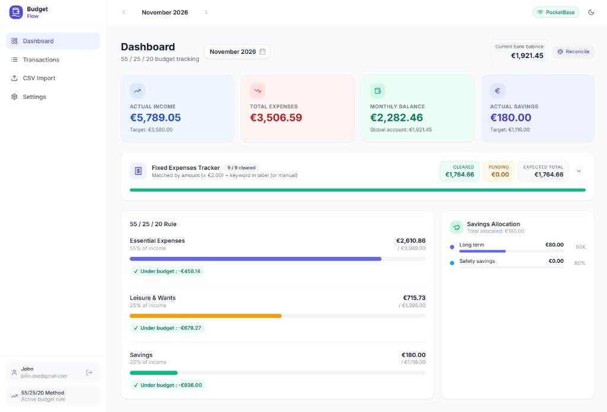

<div align="center">
  <h1><b>Budget Flow 💳🌊</b></h1>
  <p>
    <a href="./README.md">🇬🇧 English</a> &nbsp;|&nbsp; <a href="./README.fr.md">🇫🇷 Lire en Français</a>
  </p>
  <br />
  <p>
    
  </p>
</div>

**Budget Flow** est une application web (PWA) auto-hébergeable de gestion de budget familial et personnel, fondée sur la méthode **55 / 25 / 20** (Essentiel, Loisirs, Épargne) et propulsée par **PocketBase** pour une maîtrise totale de vos données financières.

---

> [!NOTE]
> **🤖 Disclaimer — Développement assisté par IA**  
> Cette application a été entièrement développée avec l'aide d'agents d'intelligence artificielle (AI Coding Agents). L'architecture produit, l'expérience utilisateur (UX/UI) et les règles métier ont été conçues et pilotées humainement, tandis que l'implémentation du code (React, TypeScript, Tailwind CSS, PocketBase) a été réalisée en binôme avec l'IA.

---

## 💡 Pourquoi j'ai créé ce projet

J'ai utilisé beaucoup d'applications de gestion de budget au fil des années, mais je n'ai jamais réussi à trouver l'ensemble des fonctionnalités que j'attendais réunies au même endroit.

**Excel** a longtemps fait le job — avec ses formules sur mesure et sa flexibilité — mais il montrait ses limites au quotidien (saisie fastidieuse, imports CSV répétitifs, ergonomie sur mobile). Avec l'avènement des **agents de code**, la porte s'est enfin ouverte pour moi qui suis **Product Designer** de métier : j'ai pu concevoir et donner vie à l'outil exact que j'avais en tête, pensé pour un usage réel, rapide et sans compromis sur l'expérience utilisateur.

---

## 📋 Pré-requis (Installation Docker)

Pour déployer **Budget Flow** et sa base de données **PocketBase** via Docker, vous aurez simplement besoin de :

- **Docker Engine** (version 20.10+) et **Docker Compose** (v2+) installés sur votre machine, NAS ou serveur.
- Deux ports disponibles sur votre hôte (par défaut) :
  - `8090` pour l'API et l'interface d'administration **PocketBase**.
  - `3000` pour l'interface web **Budget Flow**.

*(Optionnel : Node.js 18+ et Git uniquement si vous souhaitez lancer ou compiler le projet en mode développement local depuis les sources).*

---

## 🚀 Consignes d'installation

L'installation se déroule en deux étapes : la mise en route de **PocketBase** (base de données), suivie du lancement de **Budget Flow** (application front-end).

### Étape 1 : Installer et configurer PocketBase

Budget Flow s'appuie sur **PocketBase** pour stocker vos transactions, règles budgétaires, catégories, dépenses fixes et comptes du foyer.

#### A. Lancer PocketBase
Créez ou ajoutez le service `pocketbase` dans votre fichier `docker-compose.yml` :

```yaml
services:
  pocketbase:
    image: ghcr.io/muchobien/pocketbase:latest
    container_name: budget-flow-pocketbase
    restart: unless-stopped
    ports:
      - "8090:8090"
    volumes:
      - ./pb_data:/pb_data
      - ./pb_migrations:/pb_migrations
    command:
      - --dir=/pb_data
      - --migrationsDir=/pb_migrations
      - --http=0.0.0.0:8090
```

Démarrez le conteneur PocketBase :
```bash
docker compose up -d pocketbase
```
*(Alternative hors Docker : vous pouvez aussi lancer directement l'exécutable PocketBase avec `pocketbase serve --http=0.0.0.0:8090 --migrationsDir=./pb_migrations`).*

#### B. Créer le compte administrateur PocketBase
1. Ouvrez l'interface d'administration dans votre navigateur : **`http://<IP-DE-VOTRE-SERVEUR>:8090/_/`** (ou `http://127.0.0.1:8090/_/` en local).
2. Créez votre compte super-administrateur PocketBase lors du premier accès.

#### C. Importer le schéma des collections (`pb_schema.json`)
Si les migrations automatiques (`pb_migrations`) n'ont pas été montées, vous pouvez importer la structure en 3 clics :
1. Dans l'interface d'administration PocketBase, rendez-vous dans **Settings (⚙️) → Import collections**.
2. Cliquez sur **Load from JSON file** et sélectionnez le fichier `pb_schema.json` situé dans le dépôt.
3. Cliquez sur **Review** puis validez l'import pour créer automatiquement toutes les collections (`transactions`, `fixed_expenses`, `budget_rules`, `categories`, `budget_types`, `categorization_rules`, `users`, `app_status`).

---

### Étape 2 : Installer et lancer Budget Flow

Une fois PocketBase opérationnel, vous pouvez déployer **Budget Flow** directement via l'image Docker officielle `ghcr.io/flokii88/budget-flow:latest` :

1. **Ajoutez le service `budget-flow` à votre `docker-compose.yml`** :
   ```yaml
   services:
     budget-flow:
       image: ghcr.io/flokii88/budget-flow:latest
       container_name: budget-flow
       restart: unless-stopped
       ports:
         - "3000:80"
   ```

2. **Démarrez le conteneur Budget Flow** :
   ```bash
   docker compose up -d
   ```

3. **Accédez à l'application** :
   - Ouvrez **`http://localhost:3000`** (ou `http://<IP-DE-VOTRE-SERVEUR>:3000`).
   - Renseignez l'URL de votre instance PocketBase (`http://<IP-DE-VOTRE-SERVEUR>:8090`) directement depuis l'écran de connexion si nécessaire.
   - Au premier lancement, créez le **premier compte du foyer**. Une **Clé de secours personnelle** (`BF-...`) vous sera remise afin de pouvoir réinitialiser votre mot de passe à tout moment sans avoir besoin de configurer un serveur mail (SMTP).
   - Laissez-vous guider par l'**assistant de configuration pas-à-pas** !

---

## ✨ Fonctionnalités clés

### 🧭 1. Assistant d'onboarding pas-à-pas (7 étapes)
Un parcours guidé au premier lancement (relançable à tout moment) pour paramétrer votre budget en quelques minutes :
- Connexion et test de santé en direct de votre serveur **PocketBase**.
- Définition des **revenus théoriques** du foyer (mode simple ou détaillé) et choix de la **devise** (`€`, `$`, `£`, `CHF`, `¥`, etc.).
- Personnalisation des ratios **Essentiel / Loisirs / Épargne** (méthode **55 / 25 / 20** par défaut).
- Configuration des **poches d'épargne** (en montants fixes ou en pourcentages).
- Structuration des **Catégories & Types** et saisie de vos **Charges fixes** récurrentes.

### 📊 2. Tableau de bord analytique & méthode 55 / 25 / 20
- **Cartes KPI mensuelles** : Revenus réels, Dépenses totales, Solde restant du mois et Épargne cumulée.
- **Jauges budgétaires 55 / 25 / 20** : barres de progression visuelles avec indicateur immédiat de sous-budget ou de dépassement pour chaque pilier.
- **Suivi intelligent des charges fixes** : visualisation des prélèvements **déjà passés** vs **en attente** sur le mois, avec rapprochement automatique (par mot-clé et marge de tolérance en €) ou pointage manuel en un clic.
- **Ventilation de l'épargne & Graphique 6 mois** : répartition dynamique dans vos poches d'épargne et suivi de l'évolution de vos flux sur 6 mois.

### ⚡ 3. Gestion des transactions & Pointage bancaire
- **Édition en ligne ultra-rapide** : modifiez dates, libellés, montants, types et catégories directement dans le tableau sans ouvrir de fenêtre modale.
- **Filtrage contextuel** : le choix d'un Type filtre automatiquement les Catégories correspondantes.
- **Exclusion en un clic** : ignorez certaines opérations (virements internes, remboursements exceptionnels) pour ne pas fausser vos statistiques.
- **Réconciliation bancaire** : comparez le solde calculé avec le solde réel de votre compte bancaire pour détecter immédiatement tout écart.

### 🏊‍♂️ 4. Import CSV & Catégorisation automatique (Swimlanes)
- **Import CSV universel** : associez facilement les colonnes de n'importe quel export bancaire (Date, Libellé, Montant ou Débit/Crédit).
- **Détection intelligente des doublons** : repérage automatique des opérations déjà présentes (date + montant) avec arbitrage interactif avant import.
- **Moteur de règles par mots-clés** : associez automatiquement un libellé bancaire (ex. `NETFLIX`, `CARREFOUR`, `EDF`) à un Type et une Catégorie, avec application rétroactive sur tout votre historique.
- **Vue Kanban Swimlanes** : triez et classez visuellement les transactions restantes par colonnes.

### 🔐 5. Multi-utilisateurs Foyer, Sécurité & Sauvegarde
- **Gestion du foyer sans serveur SMTP** : ajoutez des membres à votre foyer via un mot de passe temporaire, et réinitialisez votre accès grâce à votre **Clé de secours personnelle**.
- **Sauvegarde & Restauration complète** : exportez et réimportez l'intégralité de votre base (JSON) ou vos transactions mensuelles (CSV), avec outils de dédoublonnage et de réinitialisation ciblée.
- **Interface moderne & Bilingue** : disponible en **Français** et **Anglais**, avec thème **Clair / Sombre** et support **PWA** (installable sur mobile et desktop).

---

## ☕ Soutenir le projet

Si **Budget Flow** vous aide au quotidien à reprendre le contrôle sur vos finances et à remplacer vos vieux fichiers Excel, vous pouvez soutenir mon travail et m'offrir un café :

[](https://buymeacoffee.com/flokii88)

👉 **[buymeacoffee.com/flokii88](https://buymeacoffee.com/flokii88)**
