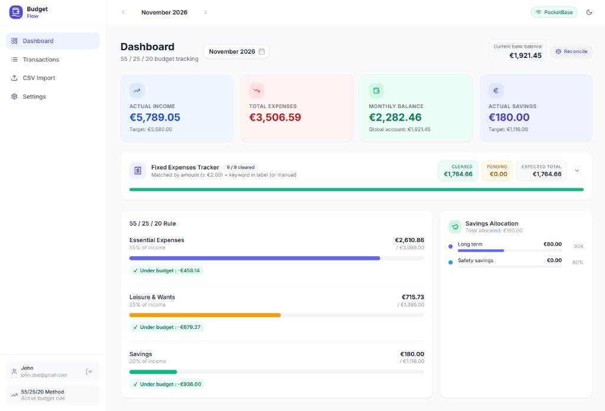

<div align="center">
  <h1><b>Budget Flow 💳🌊</b></h1>
  <p>
    <a href="./README.md">🇬🇧 English</a> &nbsp;|&nbsp; <a href="./README.fr.md">🇫🇷 Lire en Français</a>
  </p>
  <br />
  <p>
    
  </p>
</div>

**Budget Flow** is a self-hostable Progressive Web App (PWA) for family and personal budget management, built around the **55 / 25 / 20** budgeting method (Essential, Leisure, Savings) and powered by **PocketBase** for complete ownership of your financial data.

---

> [!NOTE]
> **🤖 Disclaimer — AI-Assisted Development**  
> This application was developed entirely with the assistance of AI coding agents. Product architecture, user experience (UX/UI), and business logic were designed and directed by a human, while code implementation (React, TypeScript, Tailwind CSS, PocketBase) was built in pair-programming with AI.

---

## 💡 Why I Created This Project

I have tried countless budgeting apps over the years, yet I could never find all the features I needed in one single place.

**Excel** did the job for a long time — thanks to its custom formulas and flexibility — but it quickly showed its limits in day-to-day use (tedious manual entry, repetitive CSV imports, poor mobile ergonomics). With the rise of **AI coding agents**, the door finally opened for me as a **Product Designer** by trade: I was able to design and bring to life the exact tool I had in mind, crafted for real-world daily use, fast workflows, and zero compromise on user experience.

---

## 📋 Prerequisites (Docker Installation)

To deploy **Budget Flow** and its **PocketBase** database using Docker, you only need:

- **Docker Engine** (v20.10+) and **Docker Compose** (v2+) installed on your machine, NAS, or server.
- Two available ports on your host (by default):
  - `8090` for the **PocketBase** API and Admin UI.
  - `3000` for the **Budget Flow** web interface.

*(Optional: Node.js 18+ and Git are only required if you want to run or build the project locally from source).*

---

## 🚀 Installation Guide

Installation takes place in two steps: setting up **PocketBase** (database), followed by launching **Budget Flow** (front-end application).

### Step 1: Install and Configure PocketBase

Budget Flow relies on **PocketBase** to store your transactions, budget rules, categories, fixed expenses, and household user accounts.

#### A. Start PocketBase
Create or add the `pocketbase` service in your `docker-compose.yml`:

```yaml
services:
  pocketbase:
    image: ghcr.io/muchobien/pocketbase:latest
    container_name: budget-flow-pocketbase
    restart: unless-stopped
    ports:
      - "8090:8090"
    volumes:
      - ./pb_data:/pb_data
      - ./pb_migrations:/pb_migrations
    command:
      - --dir=/pb_data
      - --migrationsDir=/pb_migrations
      - --http=0.0.0.0:8090
```

Start the PocketBase container:
```bash
docker compose up -d pocketbase
```
*(Non-Docker alternative: you can also run the PocketBase binary directly with `pocketbase serve --http=0.0.0.0:8090 --migrationsDir=./pb_migrations`).*

#### B. Create the PocketBase Admin Account
1. Open the PocketBase Admin UI in your browser: **`http://<YOUR-SERVER-IP>:8090/_/`** (or `http://127.0.0.1:8090/_/` locally).
2. Create your PocketBase super-admin account on first launch.

#### C. Import the Collections Schema (`pb_schema.json`)
If automatic migrations (`pb_migrations`) were not mounted, you can import the database schema in 3 clicks:
1. In the PocketBase Admin UI, go to **Settings (⚙️) → Import collections**.
2. Click **Load from JSON file** and select the `pb_schema.json` file located in the repository.
3. Click **Review** and confirm the import to automatically create all collections (`transactions`, `fixed_expenses`, `budget_rules`, `categories`, `budget_types`, `categorization_rules`, `users`, `app_status`).

---

### Step 2: Install and Launch Budget Flow

Once PocketBase is up and running, you can deploy **Budget Flow** directly using the official pre-built Docker image `ghcr.io/flokii88/budget-flow:latest`:

1. **Add the `budget-flow` service to your `docker-compose.yml`**:
   ```yaml
   services:
     budget-flow:
       image: ghcr.io/flokii88/budget-flow:latest
       container_name: budget-flow
       restart: unless-stopped
       ports:
         - "3000:80"
   ```

2. **Start the Budget Flow container**:
   ```bash
   docker compose up -d
   ```

3. **Access the application**:
   - Open **`http://localhost:3000`** (or `http://<YOUR-SERVER-IP>:3000`).
   - Connect your PocketBase instance URL (`http://<YOUR-SERVER-IP>:8090`) directly from the login screen if needed.
   - On first launch, create the **first household account**. A **Personal Recovery Key** (`BF-...`) will be generated so you can reset your password anytime without needing an email server (SMTP).
   - Follow the **step-by-step setup wizard**!

---

## ✨ Key Features

### 🧭 1. Step-by-Step Onboarding Wizard (7 Steps)
A guided walkthrough on first launch (which can be relaunched anytime from Settings) to set up your budget in minutes:
- Live connection and health check for your **PocketBase** server.
- Household **target income** definition (simple or detailed mode) and **currency** selection (`€`, `$`, `£`, `CHF`, `¥`, etc.).
- Custom **Essential / Leisure / Savings** ratios (**55 / 25 / 20** method by default).
- **Savings buckets** configuration (fixed amounts or percentage allocations).
- **Categories & Types** structuring and recurring **Fixed Expenses** setup.

### 📊 2. Analytical Dashboard & 55 / 25 / 20 Method
- **Monthly KPI Cards**: Actual Income, Total Expenses, Monthly Balance, and Actual Savings.
- **55 / 25 / 20 Budget Gauges**: visual progress bars with instant under-budget or over-budget indicators for each pillar.
- **Smart Fixed Expenses Tracker**: monthly view of **cleared** vs **pending** recurring bills, featuring automatic matching (by keyword and amount tolerance) or one-click manual reconciliation.
- **Savings Allocation & 6-Month Chart**: dynamic distribution across your savings buckets and a 6-month cashflow trend chart.

### ⚡ 3. Monthly Transactions & Bank Reconciliation
- **Fast Inline Editing**: edit dates, labels, amounts, types, and categories directly inside the table without modal dialogs.
- **Contextual Filtering**: selecting a Type automatically filters the available Categories.
- **One-Click Exclusion**: ignore specific transactions (internal transfers, exceptional reimbursements) so they don't skew your monthly statistics.
- **Bank Reconciliation**: compare your calculated balance against your real bank account balance to immediately spot any discrepancy.

### 🏊‍♂️ 4. CSV Import & Automated Swimlanes Categorization
- **Universal CSV Mapping**: easily map columns from any bank export (Date, Label, Amount, or Debit/Credit).
- **Smart Duplicate Detection**: automatically flags existing transactions (same date + amount) with interactive resolution before importing.
- **Keyword Rule Engine**: automatically assign bank labels (e.g., `NETFLIX`, `CARREFOUR`, `EDF`) to a Type and Category, with one-click retroactive application across your entire history.
- **Kanban Swimlanes View**: visually sort and categorize remaining imported transactions across columns.

### 🔐 5. Multi-User Household, Security & Backups
- **Zero-SMTP Household Management**: invite household members with a temporary password and reset access anytime using your **Personal Recovery Key**.
- **Full Backup & Restore**: export and re-import your entire database (JSON) or monthly transactions (CSV), complete with deduplication and targeted reset tools.
- **Modern & Bilingual UI**: available in **English** and **French**, with **Light / Dark** mode and full **PWA** support (installable on mobile and desktop).

---

## ☕ Support the Project

If **Budget Flow** helps you take back control of your finances and replace your old Excel spreadsheets, you can support my work and buy me a coffee:

[](https://buymeacoffee.com/flokii88)

👉 **[buymeacoffee.com/flokii88](https://buymeacoffee.com/flokii88)**
